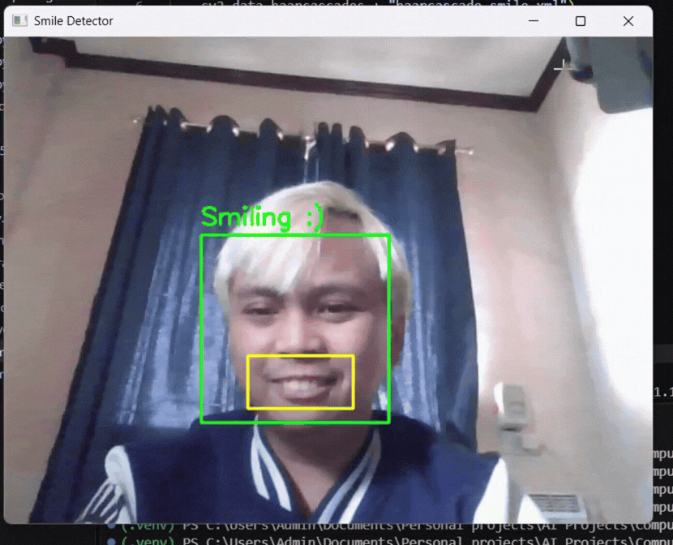
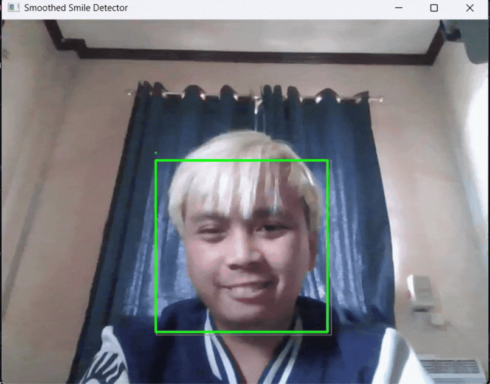

# Smiley: Real-Time Smile Detection with OpenCV

A webcam app that finds your face and tells you whether you're smiling, built step by step in Python with OpenCV. It's the first stage of a bigger goal: recognizing facial expressions and what they might mean.


## How it works

Every frame from the webcam goes through three stages:

1. **Get the image.** Read a frame from the webcam and convert it to grayscale.
2. **Find the face.** A Haar cascade face detector locates the face, and the face is cropped out as a *region of interest*.
3. **Interpret the face.** A smile detector searches **only the bottom half** of the face crop, where the mouth is.

Results are then **smoothed over time**, so the box and label stay steady instead of flickering from frame to frame.

Emotion recognition uses the same three stages. Only stage 3 changes: a trained neural network replaces the smile detector.

## The steps

The project is built in six steps, each one a separate script in [`Smiley/`](Smiley/) that adds one idea:

| Step | Script | What it adds |
|---|---|---|
| 1 | [`step1_webcam.py`](Smiley/step1_webcam.py) | Webcam frame loop; images as NumPy arrays of BGR pixel values |
| 2 | [`step2_draw.py`](Smiley/step2_draw.py) | Grayscale conversion; drawing boxes, circles and text |
| 3 | [`step3_faces.py`](Smiley/step3_faces.py) | Face detection with a Haar cascade |
| 4 | [`step4_eyes.py`](Smiley/step4_eyes.py) | Eye detection inside the face crop; a 48×48 preview of what an emotion model sees |
| 5 | [`step5_smile.py`](Smiley/step5_smile.py) | Smile detection on the bottom half of the face |
| 6 | [`step6_smooth.py`](Smiley/step6_smooth.py) | Smoothing over time: moving average, grace period, majority voting |

## What I learned

I ran experiments at each step to understand how the detectors behave and where they fail.

**Every detector has a tradeoff knob.** `minNeighbors` sets how many overlapping detections are needed before something counts. At `1`, almost anything is detected as a face; at `15`, my real face was barely detected. For smiles, `35` was the sweet spot in my setup, but hand-tuned values like this depend on lighting and distance.

**The smile detector sees contrast, not happiness.** A toothy grin is detected far more reliably than a closed-mouth smile, because bright teeth against dark lips make a strong light/dark pattern. A shocked open mouth gets detected as a "smile" too. The detector only looks at the mouth and has no context from the rest of the face, like the eyes and cheeks.

**Search where the answer can be.** Searching for eyes only in the top half of the face removed false detections on the mouth and nostrils. Every crop has its own coordinate system, so detections in the bottom half need to be shifted down by the crop's offset before drawing.

**48×48 is very small.** At the resolution used by the FER-2013 emotion dataset, I found it hard to tell my own expressions apart. Big expressions survive, but subtle ones mostly disappear.

**Smoothing trades stability for speed.** Step 6 draws the raw detection (thin gray box) next to the smoothed one (thick colored box):
- **Moving average (`ALPHA`):** a high value follows the raw detection closely but jitters. A low value is smooth but lags behind when I move.
- **Grace period (`MAX_MISSED`):** at `0`, the box disappears whenever the detector misses a single frame. With a long grace period, the box stays on screen after I've left.
- **Voting (`HISTORY`):** a long history makes the label stable, but it takes a while to switch both when I start smiling and when I stop.

In the raw version, the box jitters and the label reacts to every single frame:



With smoothing, the box moves steadily and the label only changes once most recent frames agree:



## Limitations

- **Frontal faces only.** The face detector stops finding a face once the head turns roughly 45° away.
- **Photos count as faces.** A face on a phone screen is detected just like a real one.
- **An open mouth counts as a smile,** since the smile detector only checks the mouth.
- **One face at a time.** Step 6 tracks only the largest face in view.

## Running it

Requires Python 3 and a webcam.

```powershell
python -m venv .venv
.\.venv\Scripts\Activate.ps1
pip install -r requirements.txt
cd Smiley
python step6_smooth.py
```

Press **Q** to quit. Click the video window first so it receives your key presses.

OpenCV is pinned to version 4. OpenCV 5.0 removed `cv2.CascadeClassifier`, which the face, eye and smile detectors depend on.

## Next steps

**Phase 2: emotion recognition.** Replace the smile detector with a neural network trained on the FER-2013 dataset to recognize seven emotions: angry, disgust, fear, happy, sad, surprise and neutral. The face detection and smoothing from this project will carry over as they are.
